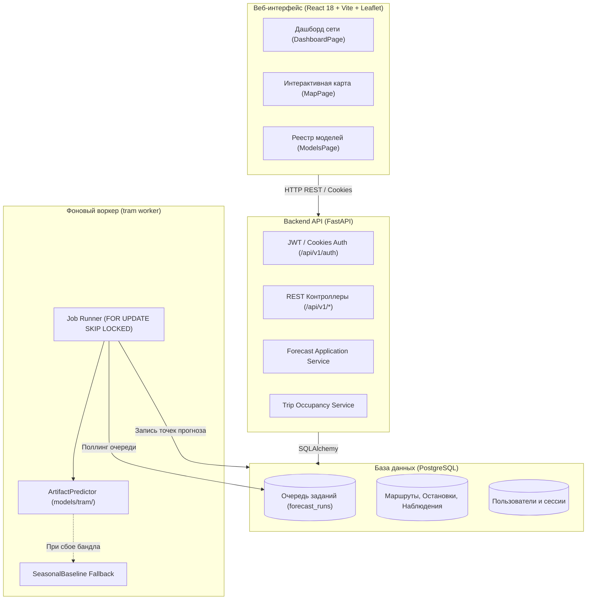

# ИИ-прогноз загрузки трамвайных маршрутов Москвы

> **Интеллектуальная система прогнозирования пассажиропотока трамвайной сети Москвы на базе Machine Learning, геопространственного анализа и Clean Architecture.**

---

## О проекте

Система предназначена для высокоточного прогнозирования пассажиропотока на трамвайной сети города Москвы с детализацией по часам, маршрутам и остановочным перегонам, а также для оперативной оценки наполненности подвижного состава.

### Ключевые возможности
- **Почасовой ML-прогноз пассажиропотока:** модели на базе градиентного бустинга (`CatBoost`, `HistGradientBoosting`) и сезонный бенчмарк (`SeasonalBaseline`), оптимизированные под соревновательную метрику **WAPE-score**.
- **Обогащение внешними данными:** непрерывный почасовой метеоархив Open-Meteo за весь 2025 год, официальный производственный календарь РФ (с учетом переносов праздников) и геопространственный слой обособленности путей от автопотока (`data/tramlanes.geojson`, 170 км).
- **Отказоустойчивый асинхронный бэкенд:** FastAPI + PostgreSQL с очередью задач на базе строгих блокировок `FOR UPDATE SKIP LOCKED`, фоновым воркером и безопасным адаптером `ArtifactPredictor` (с мгновенным fallback на сезонную модель при любых сбоях).
- **Полноценная аутентификация и безопасность:** двухфакторные сессии (JWT Bearer + HttpOnly Cookies) с разграничением ролей `viewer` (наблюдатель) и `operator` (диспетчер).
- **Интерактивный геоинтерфейс оператора:** SPA на React 18, Vite и Leaflet в фирменной дизайн-системе Московского транспорта («Мосгортранс») с тепловой картой загрузки перегонов и аналитическими графиками.

---

## Архитектура системы



---

## Быстрый старт

### Вариант 1. Запуск полного стека через Docker Compose (Рекомендуемый)

Для автоматического поднятия базы данных PostgreSQL, применения миграций, публикации справочников и одновременного запуска Backend API, Worker и Frontend выполните:

```bash
docker compose up -d
```

Либо воспользуйтесь скриптом полной сборки:
```bash
sh scripts/start-stack.sh
```

После старта сервисы доступны по адресам:
- **Веб-интерфейс:** [http://localhost:8000](http://localhost:8000) (или [http://localhost:5173](http://localhost:5173) в dev-режиме фронтенда)
- **Интерактивная документация Swagger UI:** [http://localhost:8000/docs](http://localhost:8000/docs)
- **OpenAPI спецификация:** [http://localhost:8000/openapi.yaml](http://localhost:8000/openapi.yaml)
- **Health-check:** [http://localhost:8000/api/v1/health](http://localhost:8000/api/v1/health)

#### Учетная запись оператора по умолчанию:
- **Логин:** `operator`
- **Пароль:** `Tram-Operator-2025`
- **Роль:** `operator` (право на запуск расчетов, управление моделями и симуляцию рейсов).

---

### Вариант 2. Локальный запуск разработчика

#### 1. Установка зависимостей (Python 3.12)
```powershell
# Создание и активация виртуального окружения
py -3.12 -m venv .venv
.\.venv\Scripts\Activate.ps1

# Установка зависимостей проекта и CLI tram
python -m pip install -r requirements.txt -e .

# Опционально: установка CatBoost/LightGBM для обучения
python -m pip install -e .[training]
```

#### 2. Запуск сервисов бэкенда
```powershell
# Применение миграций схемы PostgreSQL (или SQLite)
tram migrate

# Запуск HTTP REST API (Swagger UI на http://127.0.0.1:8000/docs)
tram serve

# В отдельном терминале: запуск фонового воркера прогнозирования
tram worker
```

#### 3. Запуск веб-интерфейса
```powershell
cd frontend
npm ci
npm run dev
```

---

## Машинное обучение и соревновательный конвейер

### Задача и метрика
- Прогноз почасового пассажиропотока по **10 ключевым маршрутам** Москвы: `1, 5, 7, 11, 12, 17, 25, 26, 28, 50`.
- Горизонт: ноябрь – декабрь 2025 года (14 640 строк).
- Метрика оценки:
  $$\text{WAPE-score} = \max\left(0, 1 - \frac{\sum |y - \hat{y}|}{\sum y}\right)$$
- **Регламентное правило:** предсказания для неэксплуатируемого маршрута 5 строго равны нулю ($\hat{y} = 0$).

### Обучение, валидация и экспорт моделей
```bash
# Обучение модели CatBoost с автоматическим экспортом бандла и генерацией сабмита:
python -m ml.training.tram.cli --model catboost --iterations 2000 --export-bundle catboost-v1 --set-active

# Обучение быстрой CPU-модели HistGradientBoosting:
python -m ml.training.tram.cli --model histgradient --export-bundle hgb-v1

# Валидация файла предсказаний по 8 соревновательным критериям:
python scripts/validate_submission.py ml/predictions/submission.csv

# Замер задержки инференса (latency p50/p95/p99) и пропускной способности RPS:
python scripts/benchmark_inference.py --iterations 20
```

---

## Разноуровневая документация проекта

Проект выстроен по принципу исчерпывающей разноуровневой документации: от глобальной стратегии до каждого конкретного модуля.

```
┌────────────────────────────────────────────────────────────────────────┐
│  УРОВЕНЬ 1: Корневой README.md (Точка входа, Архитектура, Quick Start) │
└───────────────────────────────────┬────────────────────────────────────┘
                                    │
    ┌───────────────────────────────┴───────────────────────────────┐
    ▼                                                               ▼
┌─────────────────────────────────────────┐  ┌─────────────────────────────────────────┐
│   УРОВЕНЬ 2: Системная база (docs/)     │  │   УРОВЕНЬ 3: Подсистемы (Subsystems)    │
├─────────────────────────────────────────┤  ├─────────────────────────────────────────┤
│ • docs/README.md       - Навигатор базы │  │ • backend/README.md   - Архитектура API │
│ • docs/ROADMAP.md      - Дорожная карта │  │ • frontend/README.md  - Клиентский SPA  │
│ • docs/ARCHITECTURE.md - Чистая схема   │  │ • ml/README.md        - ML-конвейер     │
│ • docs/ML_PIPELINE.md  - Все об ML/WAPE │  │ • models/README.md    - Реестр бандлов  │
│ • docs/API_GUIDE.md    - REST API гайд  │  │ • data/README.md      - Данные и схемы  │
│ • docs/DATASETS.md     - Реестр данных  │  │ • scripts/README.md   - Утилиты и CI    │
│ • docs/FRONTEND.md     - UI и стиль     │  │ • tests/README.md     - Набор тестов    │
│ • docs/DOCKER_STACK.md - Docker запуск  │  │                                         │
│ • docs/OPERATIONS.md   - Команды CLI    │  │   УРОВЕНЬ 4: Модульные спецификации     │
│ • docs/TESTING.md      - План проверок  │  │ • backend/src/tram/api/README.md        │
│ • docs/STATUS.md       - Статус ТЗ      │  │ • frontend/src/features/README.md       │
│ • docs/FILE_MAP.md     - Карта файлов   │  │ • ml/training/tram/README.md            │
└─────────────────────────────────────────┘  └─────────────────────────────────────────┘
```

### Навигационная таблица документации

| Раздел | Документ | Содержание |
|---|---|---|
| **Стратегия и План** | [docs/ROADMAP.md](docs/ROADMAP.md) | Регламент соревнований, правила маршрута 5, реализованные этапы E0–E6 и перспективы. |
| **Системная архитектура** | [docs/ARCHITECTURE.md](docs/ARCHITECTURE.md) | Границы Clean Architecture, взаимодействие API и воркера, баланс пассажиров. |
| **Машинное обучение** | [docs/ML_PIPELINE.md](docs/ML_PIPELINE.md) | Формулировка задачи, WAPE-score, Feature Engineering, CatBoost/HistGradient, валидация. |
| **REST API** | [docs/API_GUIDE.md](docs/API_GUIDE.md) | Руководство по эндпоинтам: JWT/Bearer аутентификация, прогнозы, карты, Swagger UI. |
| **Реестр данных** | [docs/DATASETS.md](docs/DATASETS.md) | Почасовая погода 2025, календарь РФ, геометрия путей `data/tramlanes.geojson`, метро 624/62743. |
| **Веб-интерфейс** | [docs/FRONTEND.md](docs/FRONTEND.md) | Дизайн-система Мосгортранса, интерактивная Leaflet-карта, экраны Dashboard / Map / Models. |
| **Развертывание стека** | [docs/DOCKER_STACK.md](docs/DOCKER_STACK.md) | Подробная инструкция запуска мультиконтейнерного стека через Docker Compose. |
| **Консольные операции** | [docs/OPERATIONS.md](docs/OPERATIONS.md) | Справочник команд CLI `tram`, импорта, экспорта, запуска демо и калькуляторов. |
| **Тестирование** | [docs/TESTING.md](docs/TESTING.md) | Прогон тестовых наборов Python (pytest) и Node.js (Vitest), браузерный UI smoke. |
| **Текущий статус** | [docs/STATUS.md](docs/STATUS.md) | Матрица готовности функциональных блоков к соревновательным и эксплуатационным требованиям. |
| **Карта репозитория** | [docs/FILE_MAP.md](docs/FILE_MAP.md) | Полный каталог всех поддерживаемых файлов репозитория. |

---

## Тестирование и верификация

Проект покрыт более чем 240 автоматическими тестами:

```powershell
# Запуск тестов бэкенда и ML-модулей
python -m pytest -q

# Валидация целостности документации и всех Markdown-ссылок
python scripts/check_docs.py

# Тестирование фронтенд-компонентов
cd frontend && npm test
```

---

## Файлы верхнего уровня

| Файл | Назначение |
|---|---|
| `.dockerignore` | Исключения контекста сборки Docker-образа. |
| `.env.example` | Шаблон переменных окружения (секреты, порты, подключение к БД). |
| `.gitattributes` | Настройки нормализации окончаний строк текстовых файлов в Git. |
| `.gitignore` | Правила исключения временных файлов, кэшей и тяжелых датасетов. |
| `.python-version` | Фиксация версии интерпретатора Python (3.12). |
| `alembic.ini` | Конфигурация миграций схемы базы данных PostgreSQL. |
| `compose.yaml` | Декларация мультиконтейнерного стека Docker Compose. |
| `Dockerfile` | Инструкция многоэтапной сборки контейнера бэкенда и фронтенда. |
| `openapi.yaml` | Исполняемый контракт спецификации OpenAPI 3.1.0 REST API. |
| `pyproject.toml` | Конфигурация Python-пакета, метаданные, зависимости и настройки CLI `tram`. |
| `requirements.txt` | Список зависимостей Python для продакшен-окружения. |

---

## Безопасность и правила коммитов

- Конфигурационный файл `.env`, токены доступа и приватные исходные датасеты исключены из Git (`.gitignore`).
- Пароли пользователей в базе данных защищены стойким хэшированием `bcrypt` с солью.
- Сессионные токены передаются с флагами `HttpOnly` и `SameSite=Lax`.
- Доступ к запуску вычислений ограничен ролью `operator`.
