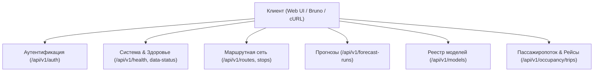
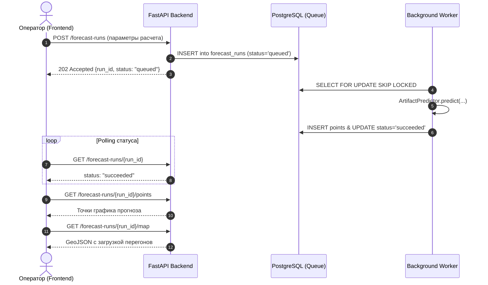

# Руководство по REST API (API Guide)

Данный документ описывает структуру, механизмы аутентификации и контракт HTTP REST API системы прогнозирования трамвайного пассажиропотока.

- **Базовый префикс:** `/api/v1`
- **Интерактивная документация (Swagger UI):** `http://localhost:8000/docs`
- **Машиночитаемая спецификация:** `http://localhost:8000/openapi.yaml`

---

## 1. Аутентификация и ролевая модель

В системе реализована двухфакторная безопасность:
1. **JWT Bearer токены:** передача через HTTP-заголовок `Authorization: Bearer <access_token>`.
2. **HttpOnly Cookies:** для безопасного взаимодействия с веб-интерфейсом токены дублируются в cookies `tram_access_token` и `tram_refresh_token` с защитой от XSS/CSRF.

### Роли пользователей
- `viewer` (наблюдатель): доступ на чтение маршрутов, остановок, исторических наблюдений и готовых прогнозов.
- `operator` (диспетчер/оператор): право на запуск асинхронных расчетов прогнозов, симуляцию рейсов, переключение активных версий моделей и регистрацию пользователей.

### Встроенная учетная запись оператора
Для локального и тестового стенда инициализируется дефолтный оператор:
- **Логин:** `operator`
- **Пароль:** `Tram-Operator-2025`
- **Роль:** `operator`

*(Учетная запись автоматически создается миграцией БД и скриптом `scripts/bootstrap-operator.py`)*.

---

## 2. Основные группы эндпоинтов

### 2.1. Аутентификация (`/api/v1/auth`)

| Метод и путь | Доступ | Назначение |
|---|---|---|
| `POST /auth/login` | Публичный | Вход пользователя. Возвращает `access_token`, `refresh_token` и профиль пользователя. |
| `POST /auth/refresh` | Публичный (по refresh token) | Обновление пары токенов без повторного ввода пароля. |
| `POST /auth/register` | Публичный | Регистрация нового пользователя с базовой ролью `viewer`. |
| `POST /auth/operators` | Только `operator` | Создание новой учетной записи с привилегированной ролью `operator`. |
| `GET /auth/me` | Авторизованный | Получение данных текущего пользователя (ID, username, роль). |
| `POST /auth/logout` | Авторизованный | Сброс сессии и очистка авторизационных cookies. |

### 2.2. Системные проверки и метаданные

| Метод и путь | Доступ | Назначение |
|---|---|---|
| `GET /health` | Публичный | Проверка работоспособности сервиса и доступности подключения к PostgreSQL. Возвращает `{"status": "ok"}`. |
| `GET /capabilities` | Публичный | Перечень поддерживаемых горизонтов, интервалов (`hour`, `day`, `month`) и доступных пространственных уровней. |
| `GET /data-status` | Публичный | Свежесть данных, версии подключенных датасетов и статус демо-режима. |

### 2.3. Маршрутная сеть и топология

| Метод и путь | Доступ | Назначение |
|---|---|---|
| `GET /routes` | Авторизованный | Список обслуживаемых трамвайных маршрутов с фильтрацией по дате действия сети. |
| `GET /routes/{route_id}` | Авторизованный | Детальная топология маршрута: список остановок по направлениям, координаты WGS-84 и GeoJSON геометрия линии. |
| `GET /stops` | Авторизованный | Реестр остановочных пунктов трамвайной сети с пагинацией и геокоординатами. |

### 2.4. Исторические наблюдения

| Метод и путь | Доступ | Назначение |
|---|---|---|
| `GET /observations` | Авторизованный | Почасовые фактические значения пассажиропотока по маршрутам за выбранный временной интервал (`from`, `to`). |

### 2.5. Асинхронные расчеты прогнозов (`/api/v1/forecast-runs`)

Генерация прогнозов построена по асинхронной модели:

| Метод и путь | Доступ | Назначение |
|---|---|---|
| `POST /forecast-runs` | Только `operator` | Создание нового задания на расчет прогноза. Возвращает статус `202 Accepted` и `run_id`. |
| `GET /forecast-runs` | Авторизованный | Список ранее запущенных расчетов с фильтрами по статусу (`queued`, `running`, `succeeded`, `failed`). |
| `GET /forecast-runs/{run_id}` | Авторизованный | Проверка текущего статуса задания и времени выполнения. |
| `GET /forecast-runs/{run_id}/points` | Авторизованный | Получение временного ряда предсказанных значений (для отрисовки графиков в веб-интерфейсе). |
| `GET /forecast-runs/{run_id}/map` | Авторизованный | GeoJSON FeatureCollection с прогнозом загрузки участков маршрутов для визуализации на карте. |

### 2.6. Реестр ML-моделей (`/api/v1/models`)

| Метод и путь | Доступ | Назначение |
|---|---|---|
| `GET /models` | Авторизованный | Список обнаруженных бандлов моделей в `models/tram/` с информацией о типе модели и WAPE-метриках. |
| `GET /models/{model_id}` | Авторизованный | Детальный паспорт модели (`model-card.md`, список гиперпараметров, SHA-256 хэш весов). |
| `POST /models/active` | Только `operator` | Переключение текущей активной модели в продакшене (обновление `active_version.txt`). |

### 2.7. Симуляция рейсов и баланс пассажиров (`/api/v1/occupancy`)

| Метод и путь | Доступ | Назначение |
|---|---|---|
| `POST /occupancy/trips` | Только `operator` | Создание плана рейса конкретного вагона по маршруту. |
| `GET /occupancy/trips/{trip_id}` | Авторизованный | Текущее состояние наполненности вагона на маршруте. |
| `POST /occupancy/trips/{trip_id}/events` | Только `operator` | Регистрация прибытия на следующую остановку и фиксация входов/выходов пассажиров. |

---

## 3. Коллекция Bruno для тестирования API

Все основные сценарии API покрыты готовой коллекцией запросов в каталоге [`bruno/`](../bruno/):
- Открытие в приложении Bruno: указать папку `bruno/`.
- Предустановленное окружение: `bruno/environments/local.bru` (базовый URL `http://localhost:8000/api/v1`).
- Автоматическое сохранение токена: при выполнении `04-login.bru` полученный access-токен автоматически сохраняется в переменную окружения `token`.
