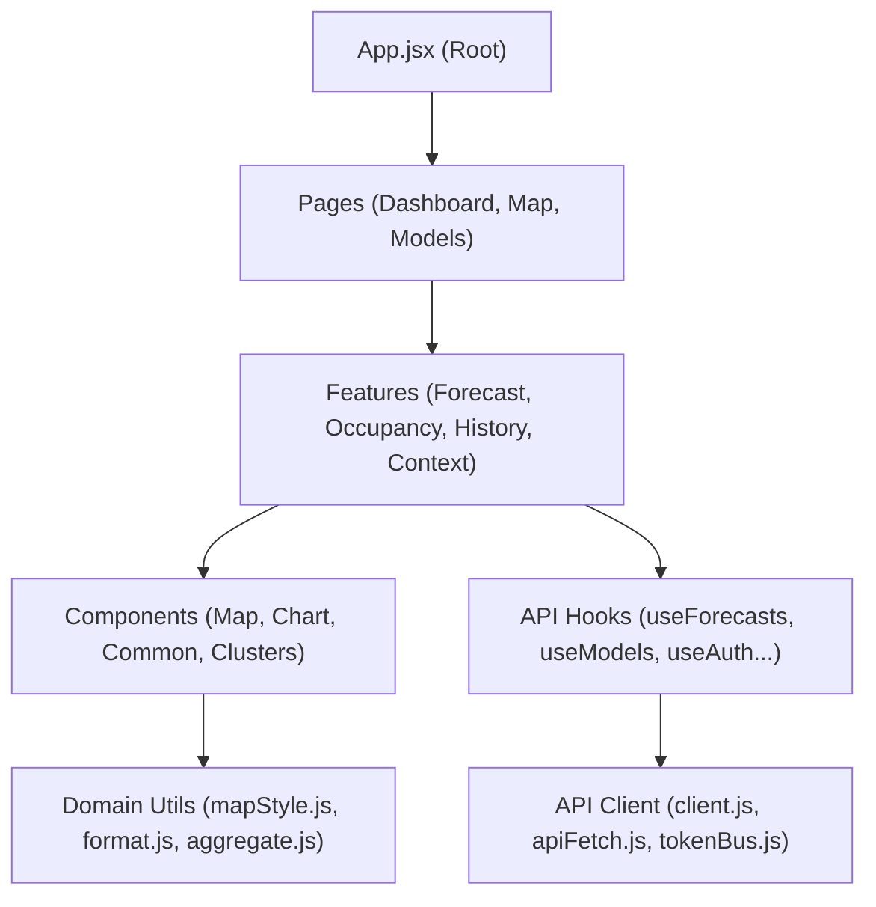

# Архитектура и руководство по веб-интерфейсу (Frontend)

В данном документе описана архитектура клиентской части системы (Single Page Application), дизайн-система Московского транспорта и структура модулей.

---

## 1. Технологический стек

- **Фреймворк:** [React 18](https://react.dev/) (JSX, функциональные компоненты, хуки).
- **Сборщик:** [Vite](https://vitejs.dev/) (мгновенный HMR, быстрая сборка).
- **Картография:** [Leaflet](https://leafletjs.com/) + кастомные слои кластеризации и полилиний на базе OpenStreetMap.
- **Стилизация:** Чистый CSS с переменными темы (`styles.css`), адаптированный под айдентику «Московский транспорт» / Мосгортранс.
- **Тестирование:** Vitest + React Testing Library (`frontend/tests/`).

---

## 2. Дизайн-система Московского транспорта

Веб-приложение полностью брендировано в соответствии с официальным дизайн-кодом Московского транспорта:

1. **Цветовая палитра:**
   - Основной транспортный синий: `#0066b3` (Мосгортранс).
   - Акцентные статусы: успех `#2e7d32`, предупреждение `#ed6c02`, перегрузка `#d32f2f`.
   - Градиенты загрузки сегментов: от свободного (зеленый) к критическому (насыщенный красный).
2. **Типографика:**
   - Официальные фирменные шрифты транспортного комплекса Москвы: `MoscowSans-Regular` и `MoscowSansExtraBold`.
3. **Графические ассеты:**
   - Фирменный паттерн «Московский узор» (`mgt_uzor_banner.svg`, `mgt_uzor_blue.svg`).
   - Официальный набор пиктограмм департамента транспорта (`fonts/DoTIcons/`).

---

## 3. Страницы приложения (Pages)

В приложении выделены 3 ключевых рабочих экрана:

### 3.1. DashboardPage (Оперативная панель)
- Сводная аналитика пассажиропотока по маршрутной сети.
- Виджет свежести данных и статуса подключения к бэкенду (`Freshness`).
- Форма настройки параметров прогноза (выбор маршрута, даты, модели).
- Интерактивный график пассажиропотока (`Chart.jsx`) с отображением доверительных интервалов.

### 3.2. MapPage (Геопространственный мониторинг)
- Полноэкранная интерактивная карта сети трамваев Москвы на базе Leaflet.
- Отрисовка геометрии линий, остановочных пунктов и станций пересадок (метро/МЦД).
- Цветовое тепловое кодирование прогнозируемой загрузки перегонов в зависимости от расчетного коэффициента наполнения.
- Всплывающие карточки остановок с детальной статистикой входов и выходов.

### 3.3. ModelsPage (Реестр и аудит ML-моделей)
- Каталог обученных моделей (`CatBoost`, `HistGradientBoosting`, `SeasonalBaseline`).
- Сравнение валидационных метрик (WAPE, MAE) по каждому маршруту.
- Панель управления активной версией модели: оператор может переключить текущую используемую модель в один клик.

---

## 4. Архитектурная структура модулей (`frontend/src/`)



### Подкаталоги
- `frontend/src/api/` — транспортный слой HTTP-запросов, обработка JWT-токенов, реактивные хуки на базе `swr`/`useEffect`.
- `frontend/src/components/` — универсальные переиспользуемые UI-компоненты (карты, графики, модальные окна, кнопки).
- `frontend/src/domain/` — чистые функции предметной логики (расчет агрегатов, форматирование дат/чисел, вычисление цветовой гаммы участков карты).
- `frontend/src/features/` — бизнес-виджеты отдельных пользовательских сценариев.
- `frontend/src/pages/` — сборные экраны пользовательского интерфейса.
- `frontend/public/` — статические файлы: шрифты, логотипы, GeoJSON схемы путей.

---

## 5. Запуск и разработка

```bash
# Переход в каталог фронтенда
cd frontend

# Установка зависимостей
npm ci

# Запуск в режиме разработки (HMR доступен по адресу http://localhost:5173)
npm run dev

# Прогон юнит-тестов
npm test

# Сборка production-бандла (сохраняется в frontend/dist/)
npm run build
```
