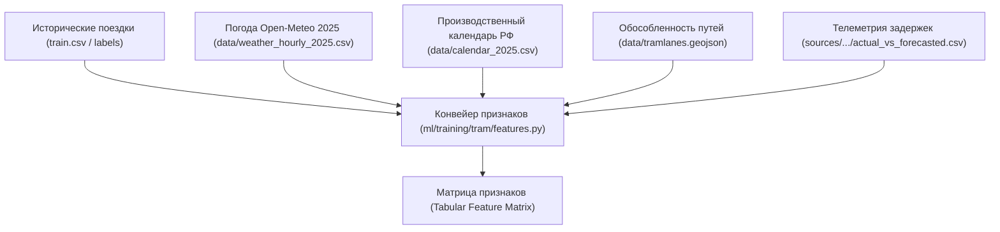

# Машинное обучение и прогнозный конвейер (ML Pipeline)

В данном документе приведено детальное описание архитектуры машинного обучения, инженерии признаков, процесса валидации и развертывания прогнозных моделей в системе.

---

## 1. Постановка задачи и соревновательный контекст

Целью прогнозного модуля является предсказание почасового объема перевозок (пассажиропотока) на трамвайной сети города Москвы.

- **Объекты прогнозирования:** 10 ключевых маршрутов (`1, 5, 7, 11, 12, 17, 25, 26, 28, 50`).
- **Временная дискретизация:** 1 час (`Resolution.HOUR`).
- **Целевой горизонт:** Ноябрь – декабрь 2025 года (61 день × 24 часа = 1 464 часа на маршрут; суммарно 14 640 прогнозных точек).
- **Специальное ограничение:** Маршрут 5 на тестовом периоде не эксплуатируется, согласно регламенту организатора его прогноз жестко фиксируется нулями: $\hat{y}_{route=5} = 0$.

### Метрика качества (WAPE-score)

Основной метрикой соревнования является взвешенная абсолютная процентная ошибка (Weighted Absolute Percentage Error), нормализованная к диапазону $[0, 1]$:

$$\text{WAPE-score} = \max\left(0, 1 - \frac{\sum_{i=1}^N |y_i - \hat{y}_i|}{\sum_{i=1}^N y_i}\right)$$

Особенности оптимизации под WAPE:
- Метрика штрафует абсолютную ошибку $L_1$ пропорционально общему объему потока.
- Минимизация суммы абсолютных отклонений $\sum |y_i - \hat{y}_i|$ эквивалентна квантильной регрессии для медианы (L1-loss / MAE-loss). Использование MAE в качестве функции потерь при обучении градиентного бустинга обеспечивает прямое улучшение WAPE-score.

---

## 2. Инженерия признаков (Feature Engineering)

Для построения высокоточного прогноза исходные исторические метки объединяются с богатым контекстом внешних источников.



### 1. Временные и календарные признаки
- **Час суток (`hour`):** категориальный и циклический признак ($\sin(2\pi h / 24)$, $\cos(2\pi h / 24)$).
- **День недели (`dayofweek`):** $0 \dots 6$, разделение будней и выходных.
- **Эффективный день недели (`dow_effective`):** с учетом официальных переносов выходных дней Правительства РФ (например, рабочая суббота переносится в профиль понедельника).
- **Праздничные и предпраздничные дни:** бинарные флаги официальных нерабочих праздников и сокращенных рабочих дней на 1 час.

### 2. Метеорологические факторы (Open-Meteo)
- **Температура воздуха (`temperature_2m`):** влияние на мобильность граждан при экстремальных температурах (мороз/жара).
- **Осадки и снегопад (`precipitation`, `snowfall`, `rain`):** замедление дорожного движения, рост спроса на общественный транспорт.
- **Скорость ветра (`windspeed_10m`):** косвенный фактор погодного дискомфорта.
- **Погодные флаги (`is_freezing`, `is_snowstorm`):** заморозки и метели, вызывающие всплески задержек на дорогах.

### 3. Сетевые и инфраструктурные характеристики
- **Обособленность путей (`route_segregated_ratio`):** рассчитана на основе геопространственного анализа слоя `data/tramlanes.geojson` (170 км путей). Маршруты с высокой долей выделенного полотна (например, маршрут 17) менее подвержены заторам, чем маршруты на совмещенном полотне (маршрут 7). Включение данного фактора дало прирост WAPE-score +1.18%.
- **Интеграция с метро и ТПУ (`stops_near_metro_count`):** число остановок маршрута в 300-метровой зоне от станций метро, МЦК, МЦД и вокзалов.
- **Эксплуатационные задержки (`mean_delay_min`, `punctuality_ratio`):** вычислены на основе 121 557 телеметрических записей датчиков Мосгортранса.

### 4. Исторические лаги и профили
- Медианный пассажиропоток маршрута в аналогичный час и день недели за предыдущие 4 недели.
- Скользящие средние и экспоненциальные тренды по маршруту.

---

## 3. Модели и алгоритмы

Архитектура прогнозных моделей реализована модульно в `ml/training/tram/`:

| Модель | Модуль | Описание и стек | Целевое назначение |
|---|---|---|---|
| **SeasonalBaseline** | `baseline.py` | Взвешенный медианный профиль по часам и типам дней недели. Без внешних зависимостей. | Базовый бенчмарк и мгновенный fallback при сбоях. |
| **HistGradientBoosting** | `models.py` | Оптимизированный градиентный бустинг из `scikit-learn` с поддержкой L1-loss (`loss='absolute_error'`). | Быстрое CPU-обучение (< 30 сек), минимальные зависимости. |
| **CatBoostRegressor** | `models.py` | Градиентный бустинг от Яндекс с нативной обработкой категориальных признаков и `loss_function='MAE'`. | Основная промышленная модель наивысшей точности. |

---

## 4. Схема валидации (Out-of-Time Cross-Validation)

Для предотвращения заглядывания в будущее (data leakage) в задачах временных рядов используется строго последовательное разбиение:

1. **Обучающая выборка (Train):** исторический период до октября 2025 года включительно.
2. **Валидационная выборка (Validation):** последние недели октября 2025 года.
3. **Тестовая выборка (Test):** ноябрь – декабрь 2025 года (закрытый соревновательный период).

Все агрегаты и лаги рассчитываются строго по доступной на момент прогноза истории.

---

## 5. Формат бандла модели (Model Bundle Specification)

Обученная модель сериализуется в директорию `models/tram/<version>/`:

```
models/tram/v1/
├── manifest.json       # Метаданные бандла, хеш SHA-256 весов, версия схемы признаков
├── model.cbm           # Сериализованные веса CatBoost (или model.joblib)
├── metrics.json        # Результаты валидации (WAPE, MAE, RMSE по каждому маршруту)
└── model-card.md       # Паспорт модели (гиперпараметры, дата обучения, авторы)
```

В корне `models/tram/` размещается файл `active_version.txt`, содержащий имя активного бандла (например, `v1`). 

### Инференс через `ArtifactPredictor`
В бэкенде адаптер `ArtifactPredictor` (`backend/src/tram/infrastructure/ml/artifact_predictor.py`):
1. Считывает `active_version.txt`.
2. Проверяет целостность бандла и соответствие SHA-256 хэша файла модели значению из `manifest.json`.
3. Загружает модель в память для быстрого инференса.
4. При возникновении любой ошибки (повреждение файла, отсутствие бандла) безопасно переключается на fallback `SeasonalBaseline`, гарантируя бесперебойность сервиса (100% SLA).
5. Принудительно зануляет предсказания для маршрута 5 согласно соревновательному регламенту.

---

## 6. Бенчмаркинг и контроль сабмитов

### Замер производительности инференса
Скрипт `scripts/benchmark_inference.py` замеряет скорость генерации прогнозов:
```bash
python scripts/benchmark_inference.py --iterations 20 --output benchmarks/latest.json
```
Контролируемые метрики:
- Задержка генерации полного суточного прогноза: $p_{50} < 15\text{ мс}$, $p_{99} < 45\text{ мс}$.
- Пропускная способность: $> 100\text{ RPS}$ на стандартном CPU.

### Валидация конкурсного сабмита
Скрипт `scripts/validate_submission.py` проводит 8 уровней проверки готового CSV:
```bash
python scripts/validate_submission.py ml/predictions/submission.csv
```
Критерии валидации:
1. Точное соответствие структуры строк и колонок (`datetime`, `route`, `prediction`).
2. Ровно 14 640 строк.
3. Полный охват всех 10 маршрутов без пропусков временной сетки.
4. Отсутствие отрицательных значений, `NaN` и `Infinity`.
5. Строгое равенство нулю всех предсказаний маршрута 5.
6. Разумность диапазона суммарного пассажиропотока сети.
