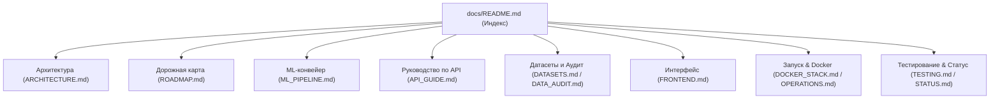

# Системная документация проекта (docs/)

Данный каталог содержит проектную и архитектурную документацию системы прогнозирования трамвайного пассажиропотока Москвы.

---

## Разделы документации

### 1. Архитектура и стратегия развития
- **[ROADMAP.md](ROADMAP.md)** — Стратегический план развития проекта: цели соревнований, правила маршрута 5, реализованные этапы (E0–E6) и направления развития.
- **[ARCHITECTURE.md](ARCHITECTURE.md)** — Границы слоев Clean Architecture, асинхронный воркер, потоки данных, баланс пассажиров и правила масштабирования.
- **[decisions/](decisions/README.md)** — Архитектурные решения (ADR): выбор Clean Architecture и стэка фронтенда React/Vite/Leaflet.

### 2. Машинное обучение и данные
- **[ML_PIPELINE.md](ML_PIPELINE.md)** — Полное руководство по машинному обучению: постановка, WAPE-score, Feature Engineering (погода, календарь, обособленность путей `tramlanes.geojson`), модели (Baseline, HistGradient, CatBoost), бандлы в `models/tram/` и валидация.
- **[DATASETS.md](DATASETS.md)** — Полный реестр используемых датасетов: внешние источники (Open-Meteo, Производственный календарь РФ № 1335, геометрия путей, телеметрия), наборы метро 624/62743 и правила интеграции.
- **[DATA_AUDIT.md](DATA_AUDIT.md)** — Аудит качества данных, разметка пропусков, временное покрытие и пространственная привязка.
- **[DATA_FORMAT.md](DATA_FORMAT.md)** — Спецификация форматов подготовленных данных: manifest, временная сетка, JSONL.
- **[DATA_SOURCES.md](DATA_SOURCES.md)** — Каталог проверенных внешних источников, официальные ссылки и сетевые проверки.
- **[METRO_PIPELINE.md](METRO_PIPELINE.md)** — Инструкция по изолированному учебному эксперименту метро (квартальный прогноз).
- **[TRAINING_PLAN.md](TRAINING_PLAN.md)** — Историческая справка по подготовке квартального пайплайна метро.
- **[DATA_LINK_CHECKS.json](DATA_LINK_CHECKS.json)** — Результаты проверки сетевой доступности внешних источников данных.
- **[DELIVERY_PLAN.md](DELIVERY_PLAN.md)** — Исторический план предыдущей итерации поставки.

### 3. Сервисы, API и Веб-интерфейс
- **[API_GUIDE.md](API_GUIDE.md)** — Исчерпывающее руководство по REST API: JWT/Bearer аутентификация, операции над сетью, прогнозы, оценки, симуляция рейсов и Swagger UI.
- **[FRONTEND.md](FRONTEND.md)** — Архитектура веб-интерфейса оператора: React 18, Vite, интерактивная карта Leaflet, дизайн-система Мосгортранса и компоненты.
- **[PASSENGER_OCCUPANCY.md](PASSENGER_OCCUPANCY.md)** — Математическая постановка симуляции рейса, восстановление высадок и баланс наполненности вагона на перегонах.

### 4. Эксплуатация, тестирование и инфраструктура
- **[DOCKER_STACK.md](DOCKER_STACK.md)** — Полное руководство по развертыванию мультиконтейнерного стека через Docker Compose (`scripts/start-stack.sh`).
- **[LOCAL_SETUP.md](LOCAL_SETUP.md)** — Пошаговая инструкция локальной настройки окружения Python 3.12, venv и зависимостей.
- **[OPERATIONS.md](OPERATIONS.md)** — Справочник консольных команд: запуск API, фонового воркера, импорта данных, тренировки моделей и CLI `tram`.
- **[TESTING.md](TESTING.md)** — Руководство по тестированию системы: юнит-тесты, интеграционные тесты, ML-валидация и фронтенд-тесты.
- **[STATUS.md](STATUS.md)** — Текущее состояние реализации функциональных блоков и подтвержденная готовность компонентов.
- **[FILE_MAP.md](FILE_MAP.md)** — Актуальная карта файлов репозитория.
- **[IMPLEMENTATION_LOG.md](IMPLEMENTATION_LOG.md)** — Журнал выполненных инженерных шагов и верификации.
