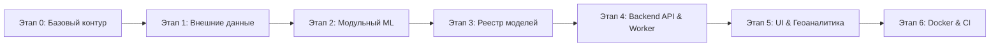

# Дорожная карта проекта (Roadmap)

В данном документе зафиксирована траектория развития системы интеллектуального прогнозирования пассажиропотока трамвайных маршрутов Москвы: от постановки задачи до промышленного эталона.

---

## 1. Цели и ключевые требования

1. **Конкурсная задача:**
   - Почасовой прогноз общего пассажиропотока по 10 ключевым трамвайным маршрутам Москвы: `1, 5, 7, 11, 12, 17, 25, 26, 28, 50`.
   - Горизонт прогнозирования: ноябрь – декабрь 2025 года (14 640 строк).
   - Метрика оценки:
     $$\text{WAPE-score} = \max\left(0, 1 - \frac{\sum |y - \hat{y}|}{\sum y}\right)$$
   - Специальное правило: по регламенту соревнований маршрут 5 строго заполняется нулями ($\hat{y} = 0$).

2. **Архитектурные требования:**
   - Чистая модульная архитектура (Clean Architecture / DDD) бэкенда на FastAPI.
   - Асинхронная очередь расчетов прогнозов через фоновый воркер с защитой от сбоев.
   - Воспроизводимый ML-пайплайн с контролем версий моделей (`models/tram/<version>/`).
   - Интерактивный геоинтерфейс оператора на React 18, Vite и Leaflet в фирменном стиле Московского транспорта.
   - Готовность к промышленному развертыванию через Docker Compose.

---

## 2. Реализованные этапы

### Этап 0: Фиксация регламента и базовой линии
- [x] Реализован сезонный алгоритм прогнозирования `SeasonalBaseline`.
- [x] Создан строгий валидатор конкурсных файлов `scripts/validate_submission.py` (проверка 14 640 строк, 10 маршрутов, формата дат, отсутствия NaN/Inf и нулевого маршрута 5).
- [x] Зафиксирован freeze-сабмит в `ml/predictions/baseline/`.

### Этап 1: Обогащение внешними данными
- [x] **Погода:** скачан и нормализован непрерывный почасовой метеоархив Москвы Open-Meteo за весь 2025 год (`data/weather_hourly_2025.csv`, 8 760 часов без пропусков).
- [x] **Производственный календарь РФ:** сгенерирован официальный календарь с учетом переносов нерабочих и праздничных дней по Постановлению № 1335 (`data/calendar_2025.csv`).
- [x] **Обособленность трамвайных путей:** оцифрован и интегрирован геодатасет 170 км путей Москвы (`data/tramlanes.geojson`) с расчетом доли выделенного полотна (`route_segregated_ratio`).
- [x] **Связность сети:** интегрирован реестр остановок с привязкой к метро, МЦК, МЦД и вокзалам (`sources/moscow-public-transport/stop_from_repo.csv`).

### Этап 2: Модульная ML-архитектура
- [x] Монолитные скрипты декомпозированы в пакет `ml/training/tram/`:
  - `features.py` — конвейер генерации временных, календарных, погодных и сетевых признаков.
  - `baseline.py` — сезонная модель.
  - `models.py` — адаптеры градиентного бустинга (`HistGradientBoostingRegressor`, `CatBoostRegressor`).
  - `evaluation.py` — Out-of-Time кросс-валидация и расчет WAPE-score.
  - `bundle.py` — версионирование и экспорт неизменяемых артефактов моделей.
  - `submission.py` — формирование валидных конкурсных файлов предсказаний.
  - `cli.py` — консольный интерфейс обучения и экспорта.
- [x] Создан бенчмарк инференса `scripts/benchmark_inference.py` для контроля latency (p50/p95/p99) и RPS.

### Этап 3: Реестр моделей (Model Registry)
- [x] Специфицирован неизменяемый формат бандла модели:
  - `manifest.json` — метаданные, хэши весов SHA-256, схема признаков.
  - `metrics.json` — валидационные метрики (WAPE, MAE, RMSE).
  - `model-card.md` — паспорт модели, гиперпараметры, авторы и ограничения.
  - `active_version.txt` — атомарный указатель на текущую активную модель в продакшене.
- [x] Реализована защита от Directory Traversal и подмены симлинков.

### Этап 4: Backend API и фоновый воркер
- [x] Чистая архитектура (Domain / Application / Infrastructure / API) на базе FastAPI и SQLAlchemy.
- [x] Реализован адаптер `ArtifactPredictor` (`backend/src/tram/infrastructure/ml/artifact_predictor.py`), загружающий бандл модели с валидацией SHA-256 и fallback на сезонную модель.
- [x] Асинхронная очередь `forecast_runs` с атомарной выборкой `FOR UPDATE SKIP LOCKED`.
- [x] Полноценная аутентификация JWT (Access + Refresh tokens в защищенных cookies) с разделением ролей `viewer` и `operator`.
- [x] Симуляция наполненности вагонов и расчет баланса пассажиров на перегонах (`docs/PASSENGER_OCCUPANCY.md`).

### Этап 5: Веб-интерфейс и геовизуализация
- [x] SPA на React 18, Vite и Leaflet.
- [x] Страницы:
  - **DashboardPage:** сводка состояния сети, оперативные метрики, фильтры и статус свежести данных.
  - **MapPage:** интерактивная карта сети трамваев Москвы, остановок, цветовое кодирование загрузки участков, детализация перегонов.
  - **ModelsPage:** мониторинг бандлов моделей, переключение активной версии, аудит метрик WAPE.
- [x] Фирменный стиль Московского транспорта: палитра Мосгортранса, официальные шрифты Moscow Sans и пиктограммы.

### Этап 6: Контейнеризация и тестирование
- [x] Настроен `Dockerfile` и мультиконтейнерный `compose.yaml` (PostgreSQL, Backend API, Worker, Nginx/Frontend).
- [x] Создан скрипт быстрого развертывания всего стека `scripts/start-stack.sh`.
- [x] Тестовое покрытие (более 240 модульных и интеграционных тестов в `tests/`).

---

## 3. Перспективные направления (Next Steps)

1. **Реалтайм-телеметрия (Streaming Data):**
   - Интеграция WebSocket / Server-Sent Events для обновления местоположения вагонов на карте в режиме реального времени.
   - Подключение шины сообщений (Kafka / RabbitMQ) для высоконагруженных потоков GPS-датчиков.
2. **Остановочная детализация (Fine-Grained Modeling):**
   - При появлении верифицированной разметки входов/выходов по каждой остановке — обучение локальных моделей на базе графовых нейронных сетей (GNN / ST-GCN).
3. **Онлайн-мониторинг дрейфа (Data & Concept Drift):**
   - Автоматический расчет метрик дрейфа распределений входящих признаков (PSI, KS-тест) и авто-триггер дообучения моделей.
